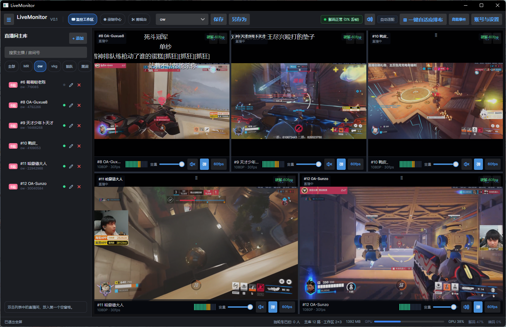
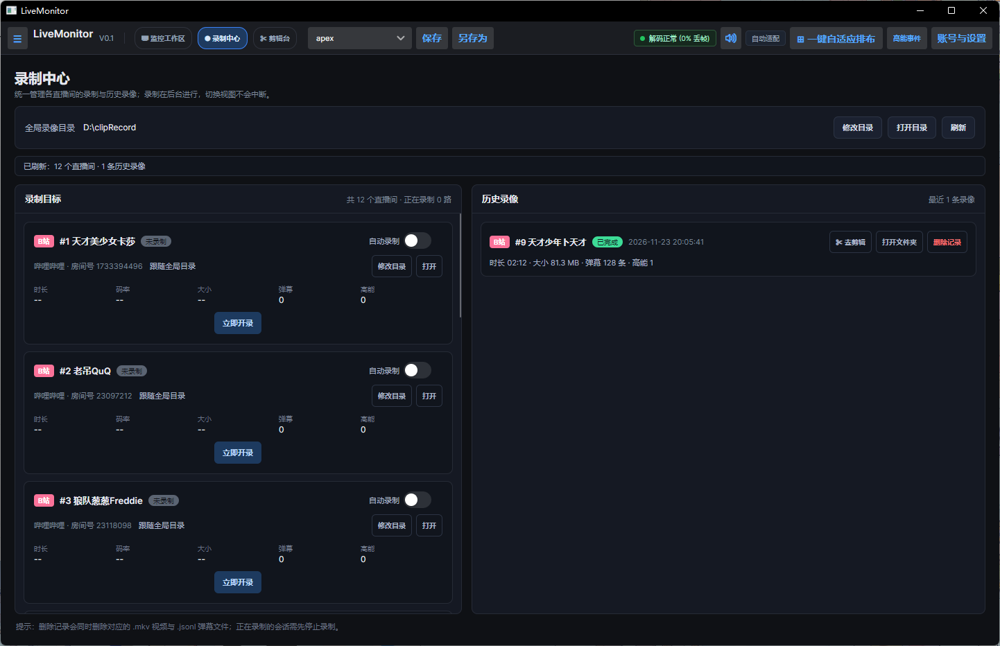

<div align="center">

# LimoClip

**多平台直播监控墙 · 弹幕高能打点 · 全程录制 · 双波形剪辑与语音转写工作台**

[](LICENSE)
[](#快速开始)
[](https://github.com/heyiai02/LimoClip/releases)

[🌐 产品主页](https://heyiai02.github.io/LimoClip/) · [⬇️ 下载绿色版](https://github.com/heyiai02/LimoClip/releases/latest) · [🎙 免费语音转写配置](#免费语音转写asr配置) · [🐛 反馈问题](https://github.com/heyiai02/LimoClip/issues)

</div>

---

LimoClip 是一款面向 Windows 桌面端的开源直播工具（基于 .NET + Avalonia + `libmpv` + FFmpeg），专为**多路同屏盯播、全程留档以及快速筛出高能切片**设计：

* **多屏监控工作区**：`libmpv` 硬件解码、按路数自动适配与分割线自由拖拽调大小、窗口方案保存与切换、焦点放大、高度自适应画质与丢帧自动降级。
* **实时弹幕与 B站独轮车过滤**：跨平台本地屏蔽词库、仅针对 B站单用户的独轮车自动拦截（豁免 $\le 6$ 字短情绪词）、滑动窗口弹幕高能实时打点。
* **独立全程录制中心**：与监控工作区彻底解耦，直录抗断电 `.mkv` 原画与同名伴随 `.jsonl` 弹幕，支持开播自动起录与异常断流自动分段。
* **双波形剪辑台 + 云端语音转写**：音频波形与弹幕密度热力曲线叠加展示，一键跳转高能区间、云端 ASR 语音转文字预览，支持秒级无损无弹幕版与硬件加速烧录弹幕版双版导出 `.mp4`。

---

## 界面预览

> 以下为实机运行截图（Windows 11、1920×1080 原画录制界面），产品页 <https://heyiai02.github.io/LimoClip/> 同步展示。

| 多屏监控工作区 | 独立录制中心 | 双波形剪辑台 + 语音转写 |
| :---: | :---: | :---: |
|  |  |  |

---

## 平台支持状态

| 平台 | 视频拉流 | 实时弹幕 | 账号登录 (WebView2) | 状态 |
| :--- | :---: | :---: | :---: | :--- |
| **Bilibili（B站）** | ✅ 原生直连 | ✅ WebSocket + 独轮车过滤 | ✅ 解锁原画与真实 UID | **已支持** |
| **Twitch** | ✅ `yt-dlp` 解析 | ✅ IRC WebSocket | ✅ 可选绑定 | **已支持** |
| **YouTube** | 🚧 规划中 | 🚧 规划中 | 🚧 规划中 | V0.5-B |
| **虎牙 / 斗鱼 / 抖音** | 🚧 规划中 | 🚧 规划中 | 🚧 规划中 | V0.5-C（独立插件热更新） |

---

## 快速开始

### 1. 下载即用（推荐普通用户）

1. 前往 [GitHub Releases](https://github.com/heyiai02/LimoClip/releases) 下载最新的 `LimoClip-*-win-x64.zip`。
2. 解压至任意**非系统保护目录**（例如 `D:\Tools\LimoClip\`），双击运行 `LiveMonitor.Desktop.exe`。
3. **关于 Windows SmartScreen 提示**：由于开源个人项目未购买商业代码签名证书，首次运行可能弹出“Windows 已保护你的电脑”，点击 **「更多信息」→「仍要运行」** 即可。

### 2. 三步上手工作流

1. **添加直播间**：在左侧主库点击 `+ 添加`，粘贴 B站或 Twitch 直播间链接；建议在右上角「账号与设置」中通过内置窗口登录 B站账号，解锁原画画质并启用完整的独轮车单用户识别。
2. **开启录制**：切到顶部 **「录制中心」**，设置保存目录（支持本地硬盘或已映射的 NAS 盘符），勾选需要自动录制的主播或手动开录。
3. **快速出片**：录播完成后点击 **「去剪辑」** 进入剪辑台，沿着弹幕热力波峰与高能打点定位片段，点击「转写」看文字确认内容，一键导出无弹幕版（秒切无损）或有弹幕版 `.mp4`。

---

## 免费语音转写（ASR）配置

LimoClip 剪辑台支持调用任意兼容 OpenAI `/v1/audio/transcriptions` 协议的云端接口对高能片段进行语音转文字，API Key 经 Windows DPAPI 加密存储在本地，且结果会自动缓存避免重复消耗额度。

在软件右上角 **「账号与设置 → 语音识别（ASR）」** 中直接选择以下内置预设并填入个人 API Key 即可：

| 推荐服务商 | 适用场景 | 推荐模型 | 说明 |
| :--- | :--- | :--- | :--- |
| **硅基流动（国内版）** | 大陆直连、中文首选 | `FunAudioLLM/SenseVoiceSmall` | 注册即有免费额度，中英混说直播口语识别准确率高 |
| **SiliconFlow（国际版）** | 海外直连、中文场景 | `FunAudioLLM/SenseVoiceSmall` | 海外节点，邮箱注册即可使用 |
| **Groq** | 海外 / 英语日语首选 | `whisper-large-v3-turbo` | 免费额度充裕、速度极快，支持分段时间戳点击跳转 |
| **自定义兼容接口** | 进阶用户 / 自建服务 | 自填 | 兼容 OpenAI、One-API、自建 Faster-Whisper 等 |

---

## 开发者构建与打包

环境要求：Windows 10/11 x64、[.NET SDK](https://dotnet.microsoft.com/download)（与 `global.json` 一致）。

```powershell
# 1. 拉取运行所需的外部二进制（libmpv / ffmpeg / yt-dlp）
powershell -ExecutionPolicy Bypass -File .\scripts\fetch-tools.ps1

# 2. 编译并运行测试
dotnet build LiveMonitor.sln
dotnet test LiveMonitor.sln

# 3. 启动桌面端
dotnet run --project src/LiveMonitor.Desktop/LiveMonitor.Desktop.csproj

# 4. 打包免环境绿色版 Release ZIP（输出至 artifacts/）
powershell -ExecutionPolicy Bypass -File .\scripts\package-release.ps1 -Version v0.5.0-beta.1
```

> 历史架构与各阶段设计文档已整理归档，详见仓库中的 `code_artifact.md`、`limoclip_v0_*.md` 与 `HANDOFF.md`。

---

## 开源协议与致谢

本项目基于 **[GNU General Public License v3.0 (GPL-3.0)](LICENSE)** 开源。

感谢以下优秀的开源项目：
* [Avalonia UI](https://avaloniaui.net/) / [Semi.Avalonia](https://github.com/irihitech/Semi.Avalonia) / [Dock.Avalonia](https://github.com/wieslawsoltes/Dock)
* [mpv / libmpv](https://mpv.io/) & [LibMpv.Avalonia](https://github.com/jmacato/LibMpv)
* [FFmpeg](https://ffmpeg.org/) & [yt-dlp](https://github.com/yt-dlp/yt-dlp)