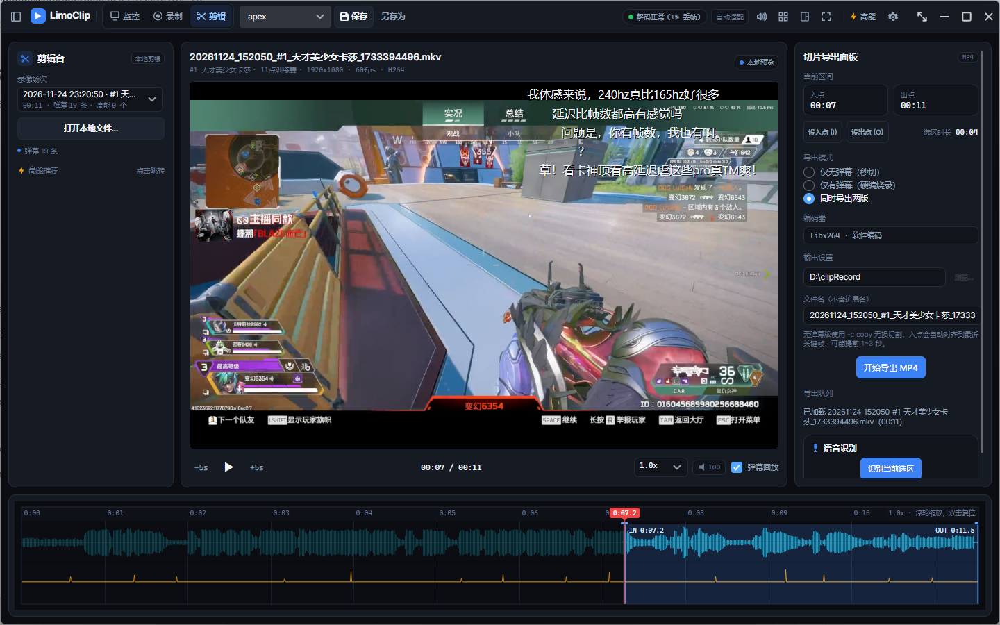

<div align="center">

# LimoClip

**多平台直播监控墙 · 弹幕高能打点 · 全程录制 · 双波形剪辑与语音转写工作台**

[](LICENSE)
[](#快速开始)
[](https://github.com/heyiai02/LimoClip/releases)

[🌐 产品主页](https://heyiai02.github.io/LimoClip/) · [⬇️ 下载绿色版](https://github.com/heyiai02/LimoClip/releases/latest) · [🎙 免费语音转写配置](#免费语音转写asr配置) · [🐛 反馈问题](https://github.com/heyiai02/LimoClip/issues)

</div>

---

LimoClip 是一款面向 Windows 桌面端的开源直播工具（基于 .NET + Avalonia + `libmpv` + FFmpeg），专为**多路同屏盯播、全程留档以及快速筛出高能切片**设计：

* **多屏监控工作区**：`libmpv` 硬件解码、按路数自动适配与分割线自由拖拽调大小、窗口方案保存与切换、焦点放大、高度自适应画质与丢帧自动降级。
* **实时弹幕与 B站独轮车过滤**：跨平台本地屏蔽词库、仅针对 B站单用户的独轮车自动拦截（豁免 $\le 6$ 字短情绪词）、滑动窗口弹幕高能实时打点。
* **独立全程录制中心**：与监控工作区彻底解耦，直录抗断电 `.mkv` 原画与同名伴随 `.jsonl` 弹幕，支持开播自动起录与异常断流自动分段。
* **双波形剪辑台 + 云端语音转写**：音频波形与弹幕密度热力曲线叠加展示，一键跳转高能区间、云端 ASR 语音转文字预览，支持秒级无损无弹幕版与硬件加速烧录弹幕版双版导出 `.mp4`。
* **自定义清流（直链）**：直接粘贴 HLS / FLV / TS / MPD / RTMP / RTSP / SRT 直链（含无后缀 CDN Token 链接）即可像本地播放器一样观看与录制，支持自定义 Referer / User-Agent 绕过防盗链；清流无弹幕，其余录制/剪辑/ASR 能力复用。

---

## 界面预览

> 以下为实机运行截图（Windows 11、1920×1080 原画录制界面），产品页 <https://heyiai02.github.io/LimoClip/> 同步展示。

| 多屏监控工作区 | 独立录制中心 | 双波形剪辑台 + 语音转写 |
| :---: | :---: | :---: |
|  |  |  |

---

## 项目架构

<p align="center">
  <a href="https://heyiai02.github.io/LimoClip/architecture.html">
    
  </a>
</p>

> 上图为项目架构总览（使用 [Archify](https://github.com/tt-a1i/archify) 生成）：从桌面壳、监控工作区、libmpv 播放、弹幕引擎、平台插件层，到录制/剪辑/ASR 与本地数据层的完整链路。点击图片打开**可交互版本**（节点聚焦、上下游追踪、路径高亮、明暗主题切换），各模块的具体实现方式见 [ARCHITECTURE.md](ARCHITECTURE.md)。

---

## 平台支持状态

| 平台 | 视频拉流 | 实时弹幕 | 账号登录 (WebView2) | 状态 |
| :--- | :---: | :---: | :---: | :--- |
| **Bilibili（B站）** | ✅ 原生直连 | ✅ WebSocket + 独轮车过滤 | ✅ 解锁原画与真实 UID | **已支持** |
| **Twitch** | ✅ 原生 GQL + Usher（去广告 embed）／`yt-dlp` 兜底 | ✅ IRC WebSocket | ✅ 可选绑定 | **已支持** |
| **YouTube** | ✅ `yt-dlp` 解析（含分离音轨合并） | ✅ InnerTube 实时弹幕 | ✅ 内置插件 + Cookie 注入 | **已支持**（V0.5-B） |
| **虎牙（Huya）** | ✅ 移动端接口 FLV + Cookie 注入（HS 优先线路、多档 ratio） | ✅ wsapi Tars 弹幕协议 | ✅ 登录 Cookie 参与拉流与弹幕 | **已支持**（V0.5-C／V0.5-D） |
| **斗鱼** | ✅ getH5Play 签名拉流（Jint 执行 `ub98484234`）+ Cookie 注入 | ✅ STT 弹幕（`danmuproxy:8601`） | ✅ 登录 Cookie 参与拉流 | **已支持**（V0.5-C／V0.5-D） |
| **抖音** | ✅ enter API 拉流（ttwid + Cookie） | ✅ Protobuf PushFrame 弹幕（`sign.js` 签名 + 自动 ack） | ✅ 登录 Cookie 参与拉流与弹幕 | **已支持**（V0.5-C／V0.5-D） |
| **自定义清流** | ✅ 直链交给 libmpv/FFmpeg（HLS/FLV/TS/MPD/RTMP/RTSP/SRT、Token 直链） | —（无弹幕源） | —（可选 Referer/UA 请求头） | **已支持**（V0.6-A） |

> 注：虎牙 CDN 对海外 / 非大陆网络有拉流限制（实测窗口约 0.5~5 秒即被服务端断开），国内网络下可正常播放/录制。斗鱼与抖音不受此限制。斗鱼 CDN 的 HTTPS 需要随包 CA（应用已内置，仅对 https 输入生效）；抖音匿名拉流地址为 http，不需要 CA。抖音弹幕签名依赖第三方 `sign.js`（AGPL-3.0，不随仓库分发）：插件会在首次使用时自动下载并缓存到 `%LocalAppData%/LiveMonitor/cache/douyin/sign.js`，也可用环境变量 `LIMOCLIP_DOUYIN_SIGN_JS` 指定本地文件。

---

## 近期版本亮点（V0.5 系列）

* **V0.5-A · 云端语音转写**：剪辑台接入 OpenAI 兼容 ASR 接口，内置硅基流动 / SiliconFlow / Groq / 自定义四套预设，API Key 本地 DPAPI 加密、结果自动缓存。
* **V0.5-B · 平台插件底座 + YouTube**：`IPlatformPlugin` + Ed25519 验签插件热更新；YouTube 支持 yt-dlp 拉流（含分离音轨）与 InnerTube 实时弹幕。
* **V0.5-C · 虎牙 / 斗鱼 / 抖音**：三平台原生拉流与弹幕协议全部内置，六平台同屏监控。
* **V0.5-D · 六平台账号登录**：B站 / Twitch / YouTube / 虎牙 / 斗鱼 / 抖音 均可在「账号与设置」内通过 WebView2 登录，Cookie 加密保存并注入拉流/弹幕请求。
* **V0.5-E/F · 虎牙断流修复**：拉流改走 HS 稳定线路 + 多档 `ratio` 画质；录制改为**分段录制 + 停止时合并去重**，解决 CDN 单连接 3~17 秒断开导致的录制损坏。
* **V0.5-G · 界面与布局**：左侧分组自动换行滚动、桌面级全屏（F11 / Esc）、「主副屏」非对称布局；Twitch 去广告三层降级（代理模板 → 原生 GQL+Usher → yt-dlp 兜底）。
* **V0.5-H · 沉浸模式 + Twitch embed**：桌面全屏/焦点模式下鼠标空闲 2.5 秒自动隐藏顶部提示与窗格控制条；Twitch 原生通道固定 `embed` 播放参数，规避直播流内插播广告。
* **V0.6-A · 自定义清流（直链）**：支持直接粘贴 HLS/FLV/TS/MPD/RTMP/RTSP/SRT 直链或无后缀 Token 链接观看与录制；可编辑播放地址（换 Token 不丢槽位）与 Referer/UA 请求头；清流无弹幕、不参与自动录制轮询，其余录制/剪辑/ASR 能力完全复用。

---

## 平台插件与热更新（V0.5-B）

- **内置平台**：B站（原生直连 + 独轮车过滤）、Twitch（yt-dlp + IRC 弹幕）、YouTube（yt-dlp 状态解析 + InnerTube 实时弹幕）、虎牙（移动端拉流接口 + wsapi Tars 弹幕）、斗鱼（getH5Play 签名拉流 + STT 弹幕）、抖音（enter API 拉流 + Protobuf 弹幕）均已内置可用。
- **平台插件**：`IPlatformPlugin` + `providers-manifest.json` + Ed25519 签名验签；插件 DLL 放入 `%LocalAppData%\LiveMonitor\plugins\{pluginId}\` 即可加载，签名校验失败或版本低于内置时自动回退内置实现。
- **更新入口**：软件「账号与设置 → 组件与插件更新」可检查/更新 `yt-dlp`，以及检查/下载/安装平台插件（无活跃录制时立即生效，否则下次启动生效）。
- **插件清单**：仓库 `plugins/providers-manifest.json`（当前为空数组，表示暂无已发布插件更新，检查结果显示「已是最新」）；签名与打包工具见 `scripts/PluginSigner`、`scripts/sign-plugin.ps1`、`scripts/build-plugins.ps1` 与 `plugins/README.md`。

---

## 快速开始

### 1. 下载即用（推荐普通用户）

1. 前往 [GitHub Releases](https://github.com/heyiai02/LimoClip/releases) 下载最新的 `LimoClip-*-win-x64.zip`。
2. 解压至任意**非系统保护目录**（例如 `D:\Tools\LimoClip\`），双击运行 `LiveMonitor.Desktop.exe`。
3. **关于 Windows SmartScreen 提示**：由于开源个人项目未购买商业代码签名证书，首次运行可能弹出“Windows 已保护你的电脑”，点击 **「更多信息」→「仍要运行」** 即可。

### 2. 三步上手工作流

1. **添加直播间**：在左侧主库点击 `+ 添加`，粘贴 B站、Twitch、YouTube、虎牙、斗鱼或抖音直播间链接；也可直接粘贴 HLS/FLV/RTMP/RTSP/SRT 等**自定义清流直链**（会提示「作为自定义清流添加」，可填写 Referer/User-Agent）。建议在右上角「账号与设置」中通过内置窗口登录平台账号——B站登录可解锁原画画质并启用完整的独轮车单用户识别，其余平台登录后 Cookie 会参与拉流与弹幕请求。
2. **开启录制**：切到顶部 **「录制中心」**，设置保存目录（支持本地硬盘或已映射的 NAS 盘符），勾选需要自动录制的主播或手动开录。
3. **快速出片**：录播完成后点击 **「去剪辑」** 进入剪辑台，沿着弹幕热力波峰与高能打点定位片段，点击「转写」看文字确认内容，一键导出无弹幕版（秒切无损）或有弹幕版 `.mp4`。

---

## 免费语音转写（ASR）配置

LimoClip 剪辑台支持调用任意兼容 OpenAI `/v1/audio/transcriptions` 协议的云端接口对高能片段进行语音转文字，API Key 经 Windows DPAPI 加密存储在本地，且结果会自动缓存避免重复消耗额度。

在软件右上角 **「账号与设置 → 语音识别（ASR）」** 中直接选择以下内置预设并填入个人 API Key 即可：

| 推荐服务商 | 适用场景 | 推荐模型 | 说明 |
| :--- | :--- | :--- | :--- |
| **硅基流动（国内版）** | 大陆直连、中文首选 | `FunAudioLLM/SenseVoiceSmall` | 注册即有免费额度，中英混说直播口语识别准确率高 |
| **SiliconFlow（国际版）** | 海外直连、中文场景 | `FunAudioLLM/SenseVoiceSmall` | 海外节点，邮箱注册即可使用 |
| **Groq** | 海外 / 英语日语首选 | `whisper-large-v3-turbo` | 免费额度充裕、速度极快，支持分段时间戳点击跳转 |
| **自定义兼容接口** | 进阶用户 / 自建服务 | 自填 | 兼容 OpenAI、One-API、自建 Faster-Whisper 等 |

---

## 开发者构建与打包

环境要求：Windows 10/11 x64、[.NET SDK](https://dotnet.microsoft.com/download)（与 `global.json` 一致）。

```powershell
# 1. 拉取运行所需的外部二进制（libmpv / ffmpeg / yt-dlp）
powershell -ExecutionPolicy Bypass -File .\scripts\fetch-tools.ps1

# 2. 编译并运行测试
dotnet build LiveMonitor.sln
dotnet test LiveMonitor.sln

# 3. 启动桌面端
dotnet run --project src/LiveMonitor.Desktop/LiveMonitor.Desktop.csproj

# 4. 打包免环境绿色版 Release ZIP（输出至 artifacts/）
powershell -ExecutionPolicy Bypass -File .\scripts\package-release.ps1 -Version v0.5.0
```

> 项目架构与各模块实现方式见根目录 `ARCHITECTURE.md`；历史阶段设计文档已归档到 `docs/archive/`，仅用于追溯。

---

## 开源协议与致谢

本项目基于 **[GNU General Public License v3.0 (GPL-3.0)](LICENSE)** 开源。

感谢以下优秀的开源项目：
* [Avalonia UI](https://avaloniaui.net/) / [Semi.Avalonia](https://github.com/irihitech/Semi.Avalonia) / [Dock.Avalonia](https://github.com/wieslawsoltes/Dock)
* [mpv / libmpv](https://mpv.io/) & [LibMpv.Avalonia](https://github.com/jmacato/LibMpv)
* [FFmpeg](https://ffmpeg.org/) & [yt-dlp](https://github.com/yt-dlp/yt-dlp)